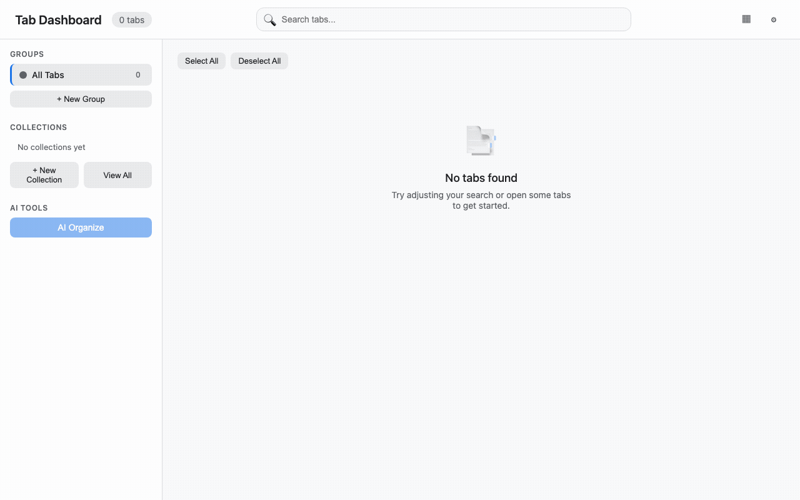

# Tab Organizer Dashboard



AI-powered Chrome extension that helps you tame tab sprawl — search, group, save, and restore tabs from a single dashboard.

> New here? [ABOUT.md](ABOUT.md) explains the why, the design decisions, and the privacy model.

## Features

- **Dashboard** — grid/list view of all open tabs with favicons, live tab-count, and real-time updates when tabs are created, moved, or closed.
- **Search** — full-text search scored by title, URL, domain, group name, and cached page content.
- **Tab Groups** — create colour-coded Chrome tab groups, re-colour them, filter the grid by group or pinned tabs, and drag tabs between groups/collections.
- **Collections** — save any selection of tabs as a named collection (URL + title only), reopen or export them later. Add links manually, export to Markdown, or copy to clipboard.
- **AI recipes** — type what you want in plain English ("close all gmail tabs", "group my figma tabs") and the extension plans tool calls against your tabs, shows exactly what will change, waits for approval, and offers undo. Built-in recipes cover grouping ungrouped tabs, saving a session, and closing duplicates.
- **AI Organize** — describe your tabs to Claude (Sonnet 4) and apply suggested groupings in one click; without a key the button prompts for Settings — `AI.quickCategorize(tabs)` is available programmatically as a heuristic fallback.
- **Dark mode & keyboard shortcuts** — `j`/`k` navigation, `/` to search, `Space` to select, `Enter` to open, `g`/`c` for quick group/collection.

## Project Structure

```
tab-organizer/
├── src/                # Canonical source (MV3 + TypeScript + Vite)
│   ├── manifest.json   # MV3 manifest (service_worker: background.js)
│   ├── background/     # Service worker — tabs, groups, content extraction, message router
│   │   ├── index.ts    # Entry: action.onClicked + runtime.onMessage + alarms cleanup
│   │   ├── router.ts   # handleMessage action dispatcher
│   │   ├── tabs.ts     # listAllTabs / getTabGroups (tabGroups mirror)
│   │   ├── groups.ts   # create/update/delete tab groups
│   │   ├── collections.ts # reopenCollection (privileged chrome.tabs.create)
│   │   └── content/    # extractPageContent + batched getAllTabsContent (BATCH_SIZE 5)
│   ├── newtab/         # Dashboard UI — ESM app with CSS variables + dark mode
│   │   ├── index.html  # Dashboard markup (toolbar, sidebar, modals)
│   │   ├── main.ts     # ESM entry: loadSettings → loadTabs → render → live updates
│   │   ├── newtab.html # Legacy HTML (preserved for reference)
│   │   ├── newtab.js   # Legacy app shim (window.* globals)
│   │   ├── app/        # Modular app: state, render, groups, collections, dnd, search, keyboard
│   │   └── styles/     # newtab.css + variables.css
│   ├── shared/
│   │   ├── storage/    # chrome.storage wrapper (settings, collections, contentCache TTL 1h, legacy sessions shim)
│   │   ├── constants/  # STORAGE_KEYS, GROUP_COLORS, BATCH_SIZE, CONTENT_TTL, CONTENT_LIMIT
│   │   └── types/      # Tab / TabGroup / Collection / Settings / ContentCache
│   └── lib/
│       ├── ai.ts       # Claude API integration + quickCategorize fallback
│       ├── search.ts   # Scored tab search (title/URL/domain/group/content)
│       └── collections/ # Collection helpers (save/reopen/export, SessionManager alias)
├── public/icons/       # Extension icons (16/48/128 px) — copied to dist/icons at build
├── tests/              # Vitest suites + legacy node harness
│   ├── compat.test.ts  # Legacy sessions → collections + TTL + darkMode round-trip
│   ├── storage.test.ts # Storage CRUD + TTL + legacy shim
│   └── test-utils.js   # Legacy mockChrome harness (no browser required)
├── scripts/
│   ├── verify-build.js # Asserts dist/manifest fields == src/manifest, dist/background.js + index.html
│   └── package-zip.js  # Zips dist/ → release/tab-organizer-<version>.zip
├── dist/               # Build output (Load Unpacked target) — background.js at root
├── .archive/           # Previous flat artifact roots retained one release for diff reference
└── vite.config.ts      # Vite build: lib entry → dist/background.js + static copy of manifest/newtab/icons
```

`SessionManager` is preserved as an alias of `CollectionManager` for backwards compatibility.

## Development

```bash
pnpm install          # install deps
pnpm dev              # Vite watch build → dist/
pnpm build            # one-shot production build → dist/
pnpm package          # zip dist/ → release/tab-organizer-<version>.zip
```

### Load in Chrome

1. Run `pnpm build` (or `pnpm dev` for watch).
2. Open `chrome://extensions` and enable **Developer mode**.
3. Click **Load unpacked** and select the `dist/` folder.
4. Click the extension icon to open the dashboard.

### Testing

```bash
pnpm test             # Vitest — all suites in tests/*.test.ts + src/**
npm run test:legacy   # Legacy harness — tests/core.test.js + tests/collections.test.js
```

## Usage

| Action | How |
|---|---|
| Search tabs | Type in the header search bar |
| Filter by group | Click a group in the sidebar |
| Select tabs | Checkbox or `Space` on focused card |
| Create group | Select tabs → **Group** (or sidebar **+ New Group**) |
| Save collection | Select tabs → **Save Collection** |
| Add to collection | Select tabs → **Add to Collection**, or drag tabs onto a collection |
| Reopen collection | Click it → **Reopen All Tabs** |
| Export | **Copy to Clipboard** / **Download Markdown** per-collection or for all |
| AI organize | Set Claude API key in **Settings** (⚙) → **AI Organize** → preview → **Apply** |

### Settings

- **Claude API key** — required for AI organization; stored in `chrome.storage.sync`. Without it the AI button prompts for settings and `quickCategorize` can be used programmatically.
- **Dark mode** — toggles `data-theme="dark"` on the document root.

### Content Extraction

`background.js` injects `extractPageContent()` via `chrome.scripting.executeScript`, skipping nav/chrome/ads/hidden elements, and truncates to ~50 KB. Results are batched (5 concurrent) and cached for 1 hour via `Storage`. Restricted URLs (`chrome://`, `chrome-extension://`, `about:`, `edge://`, `brave://`, `file://`) are skipped.

## Permissions

| Permission | Why |
|---|---|
| `tabs` | List, activate, close, group/ungroup tabs |
| `tabGroups` | Create/update/query tab groups |
| `scripting` | Inject content extractor |
| `storage` | Persist settings, collections, content cache |
| `<all_urls>` | Extract page content from any tab |

## Storage

- `chrome.storage.sync` — `settings` (`darkMode`, `hasExplicitThemePreference`).
- `chrome.storage.local` — `settings` (`apiKey` only, so it never follows your Google account), `collections` (array of `{ id, name, description, createdAt, tabs }`), `contentCache` (per-tab `{ content, cachedAt }` with 1 h TTL), legacy `sessions` key.

## Architecture Notes

- `background.js` is the sole privileged layer; `newtab.js` talks to it exclusively via `chrome.runtime.sendMessage`.
- `CollectionManager` is aliased as `SessionManager` for backwards compatibility.
- Drag-and-drop uses an intersection-based detector (`checkDragIntersection`) so the drop target is the element with the greatest overlap under the dragged card.
- Live tab/group updates are debounced (100 ms) via `chrome.tabs` / `chrome.tabGroups` event listeners.

## License

MIT — see [LICENSE](LICENSE). For the longer story (why it exists, design decisions, privacy), see [ABOUT.md](ABOUT.md).
